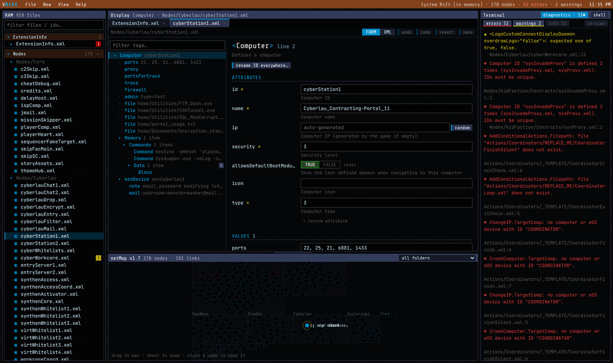
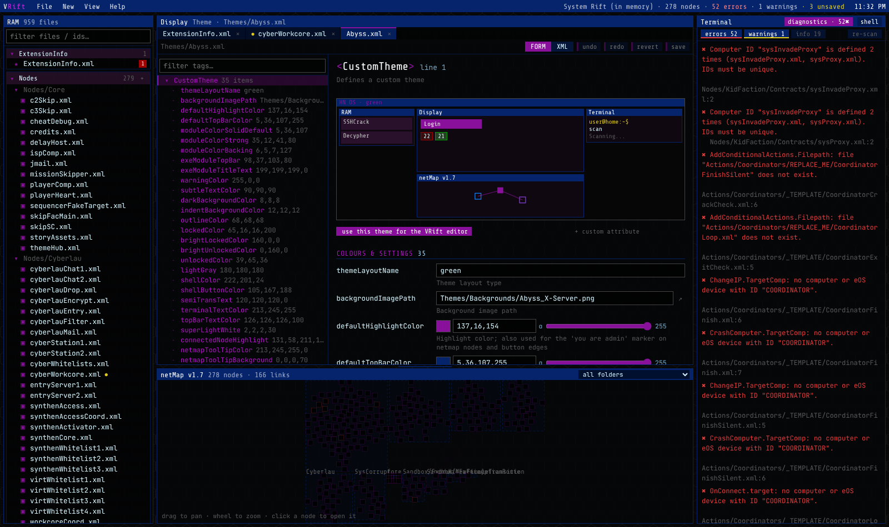

# VRift

**A visual editor for [Hacknet](https://store.steampowered.com/app/365450/Hacknet/) extensions, styled like Hacknet itself.**

Writing a Hacknet extension by hand means juggling hundreds of XML files that all point at each other by computer ID and file path. VRift loads the whole extension, understands every tag the game reads, and gives you forms, pickers and live validation instead of guesswork.





<sub>Screenshots show VRift with [System Rift](https://steamcommunity.com/sharedfiles/filedetails/?id=2123630193) loaded, one of the largest extensions on the Workshop (781 text files, 278 computers). VRift does not include any of its files.</sub>

## Features

- **Hacknet look and feel.** The RAM, Display, netMap and Terminal modules use the colours of the game's built-in themes. You can switch between Blue, Teal, Yellow, Green, White, Purple and Mint, or skin the editor with **any custom theme from your own extension**.
- **Forms for every file type.** ExtensionInfo, computers, missions, conditional actions, factions, themes, people and hacker scripts are all covered. Every attribute shows its description, and only the attributes that apply are shown. For example, a mission goal shows different fields for `filedownload` than for `AddDegree`.
- **Reference pickers.** Computer IDs, mission/action/theme files, factions, flags, IRC users and account names are offered as autocomplete. An invalid value is shown in red, and **↗** jumps to the definition.
- **Project-wide validation.** Runs as you type, using rules taken from how the game actually loads files:
  - broken computer IDs and file paths, with *"did you mean…?"* suggestions
  - duplicate IDs
  - mission elements out of order (Hacknet's mission parser only reads forward)
  - `DelayHost` computers that can't host delayed actions
  - path capitalisation that will break on Linux/macOS
  - typos in true/false values
  - attributes the game ignores
  - flags that are checked but never set
- **Rename everywhere.** Renaming a computer ID or moving a file updates every reference to it across the extension.
- **netMap.** A live graph of every computer, grouped by folder, with `dlink`s drawn as edges. Click a node to open it.
- **Raw XML whenever you want.** Every XML file has a FORM/XML toggle. VRift preserves your comments, formatting and attribute order: files you don't touch are written back byte-for-byte (tested against all 600 XML files in System Rift).
- **Hacker script editor** with syntax highlighting and a clickable command reference.
- **Theme editor** with colour pickers, Hacknet's premultiplied-alpha handling and a mini desktop preview.
- **Terminal.** Commands: `open <id>`, `refs <id>`, `find <text>`, `flags`, `nodes`, `theme <name>`, `validate`.
- **Extension library** on the start screen. VRift finds Steam (including extra Steam library drives), then lists every extension in Hacknet's `Extensions` folder and in your Workshop downloads. You can also add your own folders, which are remembered. It has search and logos. **Make copy** turns a Workshop download into an editable copy in your Extensions folder, so Steam updates can't overwrite your work.
- **Quick open** (Ctrl+P), per-file undo/redo, unsaved-change protection, and a recent-folders list.
- **Pathfinder-friendly.** Unknown tags and attributes can still be edited. Add a `VRift.schema.json` to your extension to teach VRift about tags from your mods (see [docs/custom-schema.md](docs/custom-schema.md)).

## Building on Windows

You need three things installed once:

1. **Node.js 20 or newer:** https://nodejs.org (LTS is fine)
2. **Rust:** https://rustup.rs (accept the defaults)
3. **Microsoft C++ Build Tools:** https://visualstudio.microsoft.com/visual-cpp-build-tools/ . In the installer, tick **"Desktop development with C++"**.

WebView2 is already part of Windows 10 and 11.

Check that everything is set up:

```powershell
powershell -ExecutionPolicy Bypass -File scripts\check-setup.ps1
```

Then, in this folder:

```powershell
npm install          # first time only
npm run app:dev      # run VRift with hot reload while developing
npm run app:build    # build installers
npm run app:portable # build just VRift.exe (no installer)
```

`npm run app:build` also makes installers in `src-tauri\target\release\bundle\`. If you only want the program, run `npm run app:portable`, which gives you a standalone `vrift.exe` in `src-tauri\target\release\` (this is what the GitHub releases ship).

> The first build compiles the Rust side from scratch and takes a few minutes. Later builds are much faster.

### Browser preview (no Rust needed)

`npm install` then `npm run dev`, and open http://localhost:1420. The whole UI runs in the browser. You can open a folder or the example extension, but changes stay in memory. Use the desktop app to edit real files.

### Linux and macOS

The same commands work. On Linux, install the [Tauri system dependencies](https://v2.tauri.app/start/prerequisites/#linux) first (`libwebkit2gtk-4.1-dev` and friends).

On Wayland, WebKitGTK can crash at startup with `Error 71 (Protocol error) dispatching to Wayland display` or show a blank window, mostly on NVIDIA. VRift sets `WEBKIT_DISABLE_DMABUF_RENDERER=1` and `__NV_DISABLE_EXPLICIT_SYNC=1` itself, unless you have already set them. If the problem persists, launch with `WEBKIT_DISABLE_COMPOSITING_MODE=1 ./vrift`, or force XWayland with `GDK_BACKEND=x11 ./vrift`.

### Wine / Proton

Hacknet runs under Proton, but VRift's Windows build relies on WebView2, which works poorly under Wine. On Linux (including the Steam Deck in desktop mode), build the native Linux version instead: it reads and writes the same extension folders. The code doesn't depend on Windows paths, so a project made on one OS opens on the other.

## Releasing

The version lives in the [`VERSION`](VERSION) file (currently `1.0.1`). GitHub Actions does the rest:

1. Change `VERSION` (for example `1.0.1` → `1.1.0`, plain `X.Y.Z` only).
2. Run `npm run version:sync`. This copies it into `package.json`, `package-lock.json`, `src-tauri/Cargo.toml` and `src-tauri/tauri.conf.json`.
3. Commit and push to `main`.

When `VERSION` changes on `main`, [`release.yml`](.github/workflows/release.yml) runs these steps:

- Checks that the version files agree with `VERSION`.
- Creates a draft release `v1.1.0` with notes generated from the merged commits and PRs.
- Builds VRift on each platform **without installers** and attaches one zip per platform:
  - `VRift-1.1.0-windows-x64.zip`: `VRift.exe`, run it straight from the folder
  - `VRift-1.1.0-linux-x64.zip`: the `vrift` executable (needs the system WebKitGTK library, see the included README)
  - `VRift-1.1.0-macos-universal.zip`: `VRift.app` for Intel and Apple Silicon
- Publishes the release once every build has succeeded. If a build fails, the draft and tag are deleted so you can fix the problem and push again.

If the version already has a release, the workflow does nothing, so remember to bump `VERSION`. You can also start a release by hand from **Actions → release → Run workflow**.

[`ci.yml`](.github/workflows/ci.yml) runs the tests on every push and pull request.

> The builds are not code-signed, so Windows SmartScreen will warn on first launch ("More info → Run anyway"), and on macOS you need to right-click → Open the first time.

## Tests

```powershell
npm test                                  # editor core (XML round-trip, index, validator)
cd src-tauri; cargo test --lib library    # Steam detection + extension scanning
```

To run the round-trip and validation tests against a real extension:

```powershell
$env:VRIFT_CORPUS="C:\path\to\an\extension"; npm test
```

## Documentation

- [User guide](docs/user-guide.md) — editing, forms/XML, validation, netMap, terminal commands and project safety.
- [Architecture](docs/architecture.md) — project model, round-trip XML, schema/index design, filesystem backends and build flow.
- [Development guide](docs/development.md) — setup, commands, tests, contribution patterns and releases.
- [Troubleshooting](docs/troubleshooting.md) — common runtime, editing, validation and build problems.
- [Custom schemas](docs/custom-schema.md) — teach VRift about Pathfinder mod tags.

## Project layout

```
src/
  core/        XML round-trip parser, tag schema, project model + index, validator
  schema/      hacknet.schema.json - every tag/attribute Hacknet reads (English)
  fs/          filesystem layer (Tauri backend / in-memory for the browser)
  ui/          React components (RAM explorer, Display editor, netMap, Terminal)
  templates/   new-extension and new-file templates, example extension
src-tauri/     the small Rust backend (file access, dialogs)
scripts/       schema generator, setup checker, app icon source
```

## Roadmap

- Mission flow graph (`nextMission` / branch chains as a storyline view)
- Visual action builder and a global flag timeline
- One-click hot reload into a running game through [HacknetHotReplace](https://github.com/fengxu-30338/HacknetHotReplace) + Pathfinder
- Image and web page previews; people/faction-specific views

## Credits and licence

VRift is licensed under the **GNU GPL v3.0**, see [LICENSE](LICENSE).

- The tag schema is derived from the editor hint file of [HacknetExtensionEditor](https://github.com/fengxu-30338/HacknetExtensionEditor) by fengxu-30338 (GPL-3.0). It was translated to English and extended. See `scripts/` to regenerate it.
- Loader behaviour (mission element order, delay hosts, etc.) was checked against the decompiled game in [OpenHacknet](https://github.com/forkification/OpenHacknet).
- Theme colours come from Hacknet's built-in OS themes.
- Hacknet is © Team Fractal Alligator. VRift is a fan-made tool and is not affiliated with them.
